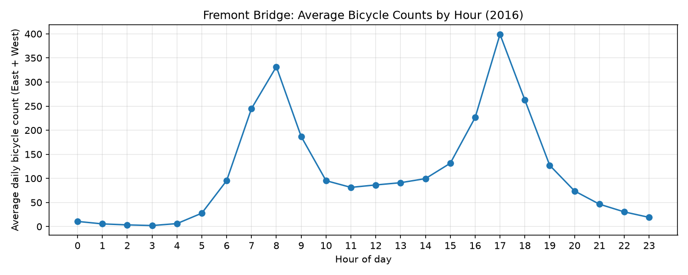

# HW1: Python Data Analysis Basics

Updated to follow the revised Canvas instructions. The required analysis
is in `src/hw1_data_analysis/hw1.py`.

I used pandas to read the CSV, convert dates and count types, and add
total, hour, and year columns. I selected 2016 and removed one row with
missing counts, leaving 8,783 valid rows.

I calculated and plotted the average East + West count by hour.
The busiest hour was 17:00, averaging 399.03 bicycles.
The plot is saved as `counts_by_hour.png`.

## Run

Save the downloaded CSV as
`hw1/src/hw1_data_analysis/bicycle_data.csv`.
The CSV is excluded from Git using `.gitignore`.

From the repository root, with the virtual environment activated, run:

`python hw1/src/hw1_data_analysis/hw1.py`

